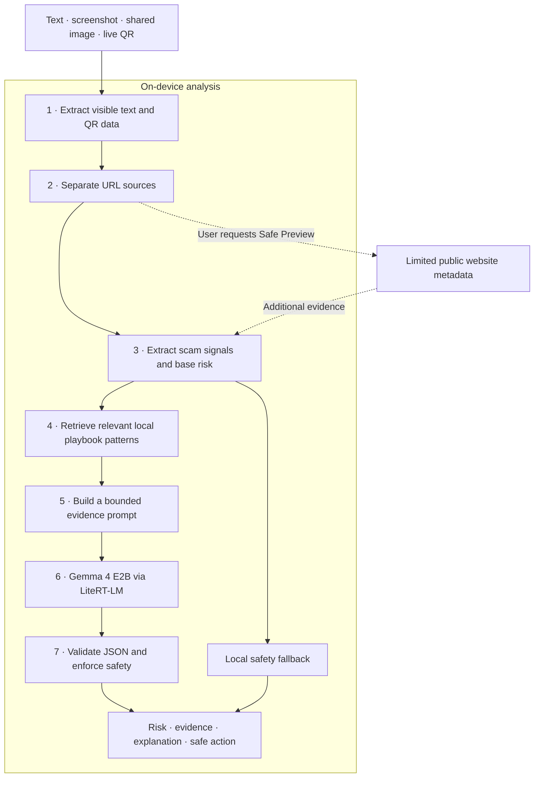
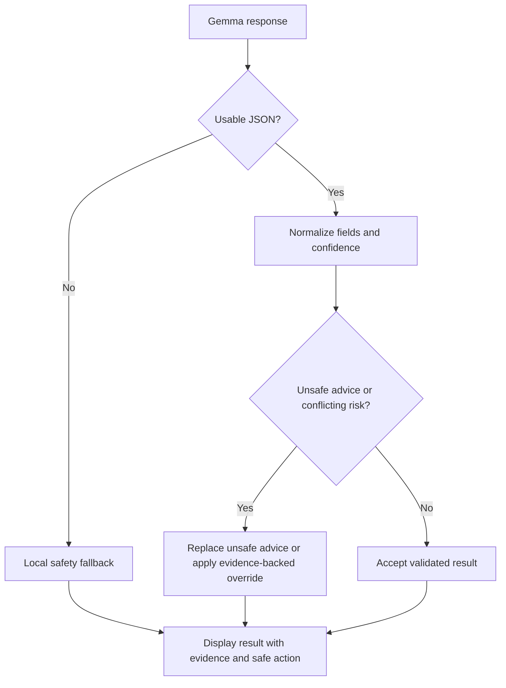

# TrustShield AI

### One Shield Before the Scam

TrustShield AI helps people assess suspicious messages, screenshots, links, and QR codes **before** they click, share a code, install an app, or pay. The Android app combines local extraction, explicit scam evidence, and on-device Gemma 4 E2B reasoning to return a risk level, a plain-language explanation, and a safer next action.

[Watch the demo](https://youtu.be/okeV1MDltAQ) · [Android APK](https://expo.dev/accounts/djexpo119/projects/trustshield-ai/builds/ac70514d-dbc4-454f-aed2-f14350e26c1b) · [Source repository](https://github.com/DiloJan-26/TrustShield-AI)

## The problem

A scam can look like a delivery notice, bank alert, mobile-data offer, job opportunity, or QR payment. Its danger often lies in a **combination** of signals: apparent authority, urgency, an unfamiliar destination, and a request for money or credentials. A risk label alone does not tell someone what the message is trying to make them do.

TrustShield is designed for older adults and other users who need to answer three questions quickly:

- **Should I stop, verify, or proceed carefully?**
- **Which clues led to that assessment?**
- **What should I do next?**

Users provide text directly, choose a screenshot, scan a live QR/barcode, or share an image through the Android share sheet. No account integration or automatic message capture is required.

## How the analysis works



The core path works offline. **Safe Preview is optional:** it makes a limited request to the selected website only when the user asks for it.

### Reasoning layers

**1. Extraction layer.** Kotlin modules use Google ML Kit to read visible Latin-script text and decode QR/barcode content from images; Google Code Scanner handles live scans. Shared images are copied into app-controlled cache. The analysis context preserves whether a URL appeared in visible text, a QR code, or manually entered text. OCR does not call a cloud service.

**2. Signal layer.** [`scamSignalExtractor.ts`](mobile-app/src/services/scamSignalExtractor.ts) turns the extracted content into observable clues, evidence, a scam-type hint, and a conservative base risk. It detects credential requests, suspicious links, brand impersonation, urgency, fees, QR payments, APK installation, and more. Combinations matter: a bank name alone is different from a bank warning demanding an OTP.

**3. Playbook layer.** [`scamPlaybook.ts`](mobile-app/src/services/scamPlaybook.ts) contains curated scam and safe-notice patterns relevant to Sri Lanka. Its local retriever scores signal overlap, keywords, URLs, scam-type hints, and risk. Up to three matching patterns enter the model context. This is a compact retrieval-augmented generation layer without a remote database or embedding service.

**4. Model layer.** Base Gemma 4 E2B runs through LiteRT-LM on the Android GPU. The prompt contains only the evidence needed for this decision:

- trimmed message/OCR text and up to three detected URLs with source context;
- up to eight signals, four evidence items, and the rule-risk hint;
- the scam-type hint and up to three compact playbook matches;
- up to two optional Safe Preview results.

The full playbook and any training dataset stay out of the prompt. The current implementation limits message text to 360 characters, uses temperature `0.1`, and requests up to 96 output tokens. Gemma produces a short structured judgment: risk, confidence, category, explanation, and safest action.

```json
{"r":"dangerous","c":0.82,"t":"delivery_fee_scam","x":"The message asks for a fee to release a parcel.","a":"Check the delivery in the courier's official app."}
```

Here `r` is risk, `c` is confidence, `t` is the category, `x` explains the apparent intent, and `a` is the next action. The parser turns this compact response into the fuller result shown in the app.

**5. Parser and fallback layer.** [`jsonModelParser.ts`](mobile-app/src/services/model/jsonModelParser.ts) recovers JSON where possible, validates fields, calibrates confidence, and filters unsafe advice. When a low-confidence model answer conflicts with strong dangerous evidence, it can use a conservative local result. Missing or failed model inference also falls back to local analysis. The result identifies whether base Gemma, mock mode, or local fallback was used.



The safety layer filters instructions to click unknown links, share OTP/PIN/password/CVV, install message-supplied APKs, send money, pay first, or reply with verification codes.

## A concrete example

Consider a screenshot claiming that a parcel is held until a delivery fee is paid at an unfamiliar URL. The app extracts the screenshot text, tags the visible URL, identifies the delivery and payment signals, and retrieves a delivery-fee scam pattern. Gemma then explains the apparent request using that evidence; the parser checks the response before the result is shown.

```text
Input       Parcel held. Pay the delivery fee at an unfamiliar link.
Evidence    Delivery context + payment request + unverified URL
Playbook    Delivery-fee pattern
Result      Risk, reasons, and a prompt to verify through the courier's official channel
```

This illustrates the analysis path; it is not an accuracy measurement or a verbatim model trace.

## Image, QR, and link safety

Screenshots can contain visible text **and** a QR code with a different destination. TrustShield processes both and keeps their URL sources separate. Local URL intelligence checks protocols, domains, shorteners, suspicious top-level domains, brand-impersonation hints, and risky path terms such as `verify`, `claim`, `payment`, and `login`.

When explicitly requested, QR Safe Preview or URL Safety Preview adds bounded public metadata: final URL, redirect count, HTTP status, content type, title, and description. It accepts HTTP/HTTPS only, blocks local and private targets, follows at most two redirects, uses a five-second timeout, and reads at most 100 KiB of HTML. It does not render a WebView, execute JavaScript, submit forms, or install files.

**Privacy boundary:** messages, screenshots, extracted text, prompts, and model responses are processed locally. A Safe Preview request contacts the selected public website, so that optional URL check needs network access. No hosted AI or TrustShield analysis server receives the message.

## Android implementation and product experience

The app uses an Expo custom development client because its OCR, barcode, share-intent, notification, and Gemma features require native Kotlin modules. The Gemma bridge verifies the external model file, initializes a reusable LiteRT-LM GPU engine, prevents concurrent generation, closes one-shot conversations, and reports inference latency. The roughly 2.6 GB model is copied to app-readable device storage after installation; it is excluded from Git and the APK.

The result screen is deliberately direct: **risk and confidence → what the message is saying → evidence found → how to handle it**. It also shows model/privacy details and optional preview status. Risky results can open a Scam State screen, while the Scam Help & Safety page explains what evidence to save and how to verify through official channels.

Current scam coverage includes bank OTP phishing, KYC and SIM verification, fake rewards, delivery and customs fees, task jobs, loan fees, marketplace deposits, investment promises, QR payment requests, and APK malware. The local rules also recognize ordinary transaction and delivery notices so benign examples can remain distinct from scams.

## Technology stack

| Area | Implementation |
| --- | --- |
| Mobile app | React Native 0.81, Expo 54, Expo Router 6, React 19, TypeScript 5.9 |
| Android integration | Kotlin, React Native NativeModules, intents, app cache, notifications, Gradle |
| On-device model | Base Gemma 4 E2B instruction model, LiteRT-LM 0.11, GPU backend |
| Extraction | Google ML Kit Text Recognition and Barcode Scanning, Google Code Scanner |
| Reasoning | Deterministic signals, local playbook retrieval, bounded prompts, structured JSON parsing |
| Delivery and checks | EAS internal APK, TypeScript compiler, ESLint, Gradle |

## Validation and current limits

The Android prototype has been exercised on a physical Redmi Note 10 Pro. [Manual base-model notes](evaluation/base_gemma_v1_notes.md) record five scenarios: a bank OTP request, gift-card survey, delivery fee, job registration fee, and ordinary account credit. The notes also record screenshot OCR, signal display, result navigation, and latency display. A separate offline check records Gemma initialization and analysis with Wi-Fi and mobile data disabled.

These are focused acceptance checks. The project does not yet claim production accuracy or a representative benchmark. Next work includes automated per-class evaluation and false-negative review, multilingual OCR and evaluation for Sinhala and Tamil, adversarial link and OCR tests, and performance measurements across more devices. The current app focuses on English and Latin-script Sri Lankan messages; it analyzes content supplied by the user and does not read private messaging accounts or capture screenshots in the background.

## Run locally

An Android SDK, compatible JDK, Node.js/npm, and a physical Android device with USB debugging are needed for the native app.

```powershell
cd mobile-app
npm install
npm run android
npm run start:usb
```

The model is installed separately. Follow [model setup](mobile-app/models/README_MODEL_SETUP.md) to copy `gemma-4-E2B-it.litertlm` to the expected Android path, then initialize it in **Settings**. After native changes, rebuild the Android app. For TypeScript-only changes, `npm run start:usb` is usually sufficient.

```powershell
cd mobile-app
npx tsc --noEmit
npm run lint
```

More detail: [reasoning architecture](mobile-app/docs/TRUSTSHIELD_REASONING_ARCHITECTURE.md) · [Safe Link Preview](mobile-app/docs/SAFE_LINK_PREVIEW.md) · [QR Safe Preview](mobile-app/docs/QR_SAFE_PREVIEW.md) · [Scam Help & Safety](mobile-app/docs/SCAM_HELP_AND_SAFETY.md).

---
